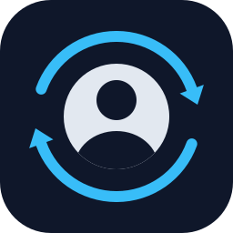

<p align="center">
  
</p>

<h1 align="center">fb-pfp</h1>

<p align="center">
  Change your Facebook profile picture from a folder of images, using your own logged-in Brave browser.
</p>

<p align="center">
  <a href="https://github.com/codethor0/fb-profile-pic-automation/actions/workflows/ci.yml"></a>
  <a href="https://github.com/codethor0/fb-profile-pic-automation/releases/latest"></a>
  <a href="LICENSE"></a>
  
  
  <a href="https://github.com/codethor0/fb-profile-pic-automation/commits/main"></a>
  <a href="SECURITY.md"></a>
  <a href="CONTRIBUTING.md"></a>
  <a href="https://github.com/sponsors/codethor0"></a>
</p>

## What it does

`fb-pfp` opens a tab in the Brave browser you already use, goes to your Facebook profile, and uploads a picture from a folder as your new profile picture. You can pick a random image, rotate through the folder without repeats, or use one fixed file. One command, no prompts, so it can run on a schedule.

It never sees your password. It drives the Brave window that is already logged in, over the Chrome DevTools Protocol on `localhost`.

## Requirements

- macOS
- Brave Browser, installed in `/Applications` and logged in to Facebook
- Python 3.11 or newer

Linux and Windows are not supported. The Brave launch and quit steps use macOS tools (`open`, `osascript`).

## Install

```bash
git clone https://github.com/codethor0/fb-profile-pic-automation.git
cd fb-profile-pic-automation
python3 -m venv .venv
.venv/bin/pip install -e .
```

Playwright is installed as a Python library only. It does not download a browser, because the tool uses your own Brave.

## Quick start

Put a few pictures (`.jpg`, `.jpeg`, `.png` or `.webp`) in a folder, then do a dry run. A dry run uploads the image into the Facebook dialog and stops before Save, so nothing is published:

```bash
.venv/bin/fb-pfp --dir ~/Pictures/profile-pics --dry-run -v
```

When that looks right, run it for real:

```bash
.venv/bin/fb-pfp --dir ~/Pictures/profile-pics
```

`python3 fb_change_pfp.py ...` works the same way if you prefer not to install the package.

## Usage

| Command | Effect |
|---|---|
| `fb-pfp --dir DIR` | Pick one image from `DIR` at random |
| `fb-pfp --dir DIR --cycle` | Rotate through `DIR`, no repeats until every image has been used |
| `fb-pfp --file FILE` | Use one specific image |
| `fb-pfp ... --dry-run` | Upload but stop before Save |
| `fb-pfp ... -v` | Debug logging, and screenshots of each step |
| `fb-pfp --version` | Print the version |

Exit status is `0` on success and `1` on any reported failure, with a one-line reason in the output. `2` means the invocation itself was rejected (unknown flag, or `--dir` together with `--file`). Ctrl-C exits `130`.

Only regular files are used. Inside `--dir`, symbolic links, hidden files and sub-folders are ignored (`--file` follows links as usual).

In `--cycle` mode an image is marked as used only after Facebook accepted it. A failed run or a dry run does not use up an image.

## Configuration

Command-line options override `FB_PFP_*` environment variables, which override the defaults.

| Variable | Meaning | Default |
|---|---|---|
| `FB_PFP_DIR` | Folder of candidate images | `./profile_pics` |
| `FB_PFP_FILE` | One specific image | none |
| `FB_PFP_BRAVE_BINARY` | Brave executable | `/Applications/Brave Browser.app/Contents/MacOS/Brave Browser` |
| `FB_PFP_BRAVE_PROFILE` | Brave profile folder | `~/Library/Application Support/BraveSoftware/Brave-Browser` |
| `FB_PFP_DEBUG_PORT` | DevTools port | `9222` |
| `FB_PFP_LOCALE` | Browser language, passed as `--lang` when this tool starts Brave | `en-US` |
| `FB_PFP_STATE_FILE` | Rotation state for `--cycle` | `~/.fb_pfp/state.json` |
| `FB_PFP_SCREENSHOT_DIR` | Where screenshots go | `~/.fb_pfp/screenshots` |
| `FB_PFP_EXPECTED_NAME` | Your Facebook display name. When set, the run refuses to act unless the browser shows this account (guards against attaching to the wrong browser or account) | none: a warning is logged |
| `FB_PFP_KEEP_BRAVE_OPEN` | Set to `1` to leave the debug-enabled Brave running after a run the tool started | browser is quit after the run |

When the tool starts Brave itself, it quits Brave again when the run finishes, so the debug port is not left open. A Brave you already had running is never quit. `run.sh` is unaffected by this.

`FB_PFP_PYTHON` is not read by `fb-pfp` itself: `run.sh` uses it to pick the Python interpreter (for example the one inside a virtual environment), defaulting to `python3`. See [docs/scheduling.md](docs/scheduling.md).

A value that cannot be used, such as a port that is not a number, stops the run with a clear message.

## Run it on a schedule

`run.sh` is the one-command entry point. It requires `PICS_DIR` and has no default, because the image it picks becomes your public profile picture:

```bash
PICS_DIR=~/Pictures/profile-pics ./run.sh
```

[docs/scheduling.md](docs/scheduling.md) has a ready-made launchd setup and cron lines.

If Brave is already running without the debug port, the tool quits it and starts it again with the port. Unsaved work in Brave windows can be lost, so close or save anything important before a scheduled run, or keep a dedicated Brave profile for this.

## How it works

1. Attach to Brave on `127.0.0.1:9222`, or start Brave with that port.
2. Open a new tab at `facebook.com/me`.
3. Click the profile picture, then "Choose profile picture".
4. Give the image to the file input inside that dialog, and only that dialog.
5. Click Save, wait for the dialog to close, and close the tab.

Buttons are found by their visible text, not by generated class names. Pauses between steps vary between runs. Facebook changes its pages without notice, so a run can stop with "button not found" after a Facebook update. [docs/architecture.md](docs/architecture.md) describes the code layout and how to add a new image source.

## Security

- No passwords, cookies or tokens are read, stored or sent by this code.
- The debug port listens on the loopback address (`127.0.0.1`) only.
- An open debug port lets any program on your Mac control your browser. See [SECURITY.md](SECURITY.md) for what that means and how to limit it.

Report vulnerabilities privately, as described in [SECURITY.md](SECURITY.md).

## Terms of service

Automating Facebook may break Meta's terms. Use this on an account you own, at your own risk. Meta can limit or disable accounts, and nothing in this project prevents that.

## Disclaimer

Not affiliated with, endorsed by, or sponsored by Meta Platforms, Inc. Facebook is a trademark of Meta Platforms, Inc.

## Contributing

Bug reports, fixes and documentation improvements are welcome. Read [CONTRIBUTING.md](CONTRIBUTING.md) first. The history of changes is in [CHANGELOG.md](CHANGELOG.md).

## Support the project

If this saves you time, you can sponsor the work through [GitHub Sponsors](https://github.com/sponsors/codethor0). Starring the repository also helps other people find it.

## License

[MIT](LICENSE)
